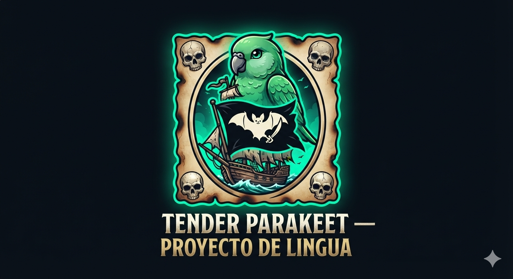

# 🏴‍☠️ TENDER PARAKEET ($THND) — PROYECTO DE LINGUA 🦜

<!-- LOGO OFICIAL CON PERICO TIERNO VERDE Y BANDERA DEL MURCIÉLAGO BLANCO HONDUREÑO -->

### 🦅 EL RECETARIO (THE GRIMOIRE) — LABORATORIO EDUCATIVO EN ROBINHOOD CHAIN 🦅

---

## 🚢 🦇 [ FLEET FLAG: HONDURAN WHITE BAT MEME-STYLE ] 🏴‍☠️ 🚢

---

<!-- CUADRO DE PERGAMINO QUEMADO CON CALAVERAS CUSTODIANDO LAS CUATRO ESQUINAS -->

| 💀 | 📜 EDICTO OFICIAL DE INTELIGENCIA NAVAL CRIPTOGRÁFICA 📜 | 💀 |
| :--- | :---: | :--- |
| | | |
| 💀 | **Transparencia Total — Cero Tokens para el Capitán — 100% Educativo** | 💀 |

---

## 🧭 Nuestro Manifiesto Único (Eslogan Oficial)

> *"Somos un proyecto comunitario y educativo. Usamos las memecoins como herramienta y las culturas de América como apoyo para evitar estafas, pérdidas de dinero y compras por impulso (FOMO). Enseñamos desde nuestra experiencia real, nunca vendiendo humo, señales, grupos VIP ni enlaces de referido. Como crecemos de forma natural, no buscamos listados rápidos, modas pasajeras ni falsas promesas de multiplicar tu dinero por 1000. Queremos avanzar paso a paso junto a la comunidad. Porque cada centavo cuenta y aprender no tiene precio."*

Nacido en **Honduras con $0 de presupuesto**, **Tender Parakeet (Project Lingua)** utiliza una red económica como taller práctico para aprender cómo funciona realmente la blockchain sin arriesgar ahorros en tarifas absurdas de gas.

---

## 🌐 Arquitectura del Ecosistema y Enlaces Oficiales

| Nombre Oficial | Función en el Ecosistema | Enlace / Coordenada Verificada |
| :--- | :--- | :--- |
| **🏥 El Hospital Cripto** (*The Crypto Hospital*) | Red Layer 2 oficial donde ocurren las operaciones reales con gas en centavos. | **Robinhood Chain** (`Chain ID: 4663`) — RPC: `https://robinhood.com` |
| **🧪 El Laboratorio On-Chain** (*The On-Chain Lab*) | Curva automática de precios donde vive el 100% del suministro antes de graduarse. | [Pons Launchpad ($THND)](https://ponsfamily.com) |
| **🔭 El Periscopio** (*The Periscope*) | Explorador abierto para auditar el contrato y verificar que no tiene dueño. | [Blockscout Robinhood Chain](https://blockscout.com) |
| **🦄 Puerto Libre Uniswap** (*Free Port Uniswap*) | Destino automático de la liquidez bloqueada al alcanzar exactamente los 4.20 ETH. | [Uniswap App](https://uniswap.org) |
| **🩺 La Consulta** (*Binance Square*) | Artículos en español de Dr. Lingua: experiencias reales y prevención de estafas. | [Binance Square](https://binance.com) |
| **⚗️ El Boticario** (*Farcaster*) | Bitácora técnica en inglés: fórmulas, pruebas en vivo y seguimiento on-chain. | [Farcaster](https://warpcast.com) |
| **⏳ Sala de Espera** (*Telegram*) | Canal comunitario en pausa temporal hasta reunir 200 miembros reales y orgánicos. | [Telegram Oficial](https://t.me) |

---

## 📊 Especificaciones Técnicas del Contrato Inteligente

Las coordenadas están grabadas de forma inmutable en la cadena de bloques. Este documento certifica los parámetros técnicos auditables de **$THND**:

* **Smart Contract (CA):** `0x54BF9EcF6b09E86DE19688E636a0368cc8844020`
* **Contrato de la Curva (Pons):** `0x16c8fe…26b2d8`
* **Red de Operación:** **Robinhood Chain** (`Chain ID: 4663`) — Combustible nativo: **ETH-RH** (ETH puenteado a Red 4663)
* **Suministro Máximo Fijo:** **1,000,000,000 $THND** (100% enviado a la curva; funciones de emisión renunciadas para siempre)
* **Asignación para el Equipo (Dev):** **0%** (Cero minado previo, cero billeteras ocultas y cero listas blancas)
* **Impuesto por Transferir (Transfer Tax):** **0%** (Contrato limpio estándar; mover tus tokens no resta monedas ni bloquea futuros listados)
* **Comisión de Creador (Creator Fee):** **3% en ETH** (Tarifa nativa del protocolo en Pons acumulada en ETH para sostener el trabajo operativo y educativo; al menos el **50%** de estas comisiones se destina a recompras y quemas por hitos comunitarios como gratitud por el apoyo, sin constituir promesa de pago ni inversión)
* **Meta de Graduación Automática:** **4.20 ETH** acumulados de forma orgánica en Pons

---

## 🗺️ La Ruta del Contrato y Bitácora de Transparencia

1. **📍 Nacimiento en la Curva de Pons:** El 100% de los tokens vive dentro del contrato automático en Pons Family. Antes de completar los 4.20 ETH, los agregadores externos mostrarán 0% de liquidez en DEX porque todo el capital permanece resguardado dentro de la curva automática.
2. **⚓ Construcción Orgánica:** Avanzamos paso a paso mediante educación real, sin bots de volumen ni marketing pagado.
3. **🌊 Meta de los 4.20 ETH:** Al alcanzar exactamente los 4.20 ETH por apoyo natural, el contrato cierra la curva automáticamente sin intervención humana.
4. **🦄 Migración a Puerto Libre Uniswap:** El código envía toda la liquidez directamente a Uniswap y quema las llaves de acceso para siempre (*LP Keys Burned*).

> **📜 Bitácora de Aprendizaje (Nota de Transparencia):**
> Al lanzar el contrato en septiembre de 2026 cometimos el error de novato de usar lenguaje típico de FOMO en la descripción inicial de Pons (texto que queda grabado de forma inmutable en la plataforma). Tras intentar construir en X sin presupuesto y ser saturados por redes de bots de spam, aprendimos que ese camino no construye nada real. Hoy mantenemos exactamente el mismo contrato limpio y renunciado, pero con un enfoque 100% educativo y libre de humo.

---

## 🛡️ Protocolo de Supervivencia Práctica (Reglas de Oro)

1. **Usa una Billetera Desechable (Burner Wallet):** Crea una cartera totalmente nueva e independiente (con su propia frase semilla de 12 palabras anotada en papel) para interactuar con contratos nuevos. Nunca uses tu cartera de ahorros principales.
2. **Verifica la Red y el ETH-RH:** Asegúrate de operar exclusivamente en **Robinhood Chain (Chain ID: 4663)** con ETH puenteado (donde el gas cuesta centavos). Haz siempre una prueba con centavos antes de mover más saldo.
3. **Configura el Antideslizamiento (Slippage) al 4%:** Ajusta el slippage manualmente en **4% mínimo** (para cubrir la comisión de curva del 3% más 1% de margen por volatilidad); nunca lo dejes en el 20% predeterminado.
4. **Cero Contacto Privado (Anti-Phishing):** Ningún miembro del equipo te escribirá jamás por mensaje directo ni te pedirá tus 12 palabras, claves privadas o verificaciones biométricas (KYC).
5. **Auditoría Propia en El Periscopio:** Antes de operar, verifica siempre en `https://blockscout.com` que el contrato sea el oficial (`0x54BF...4020`) y que la casilla `owner` esté renunciada (`0x0000...0000`).

---

## ⚠️ Decreto de Riesgo y Aviso Legal

**Tender Parakeet ($THND) — Project Lingua** es un espacio 100% educativo, cultural y comunitario basado en el patrimonio del continente americano. **No somos asesores financieros, no vendemos señales de trading, no ofrecemos acciones comerciales ni garantizamos rendimientos.**

Las memecoins operan en un entorno altamente volátil y especulativo donde puedes perder la totalidad del capital utilizado. Al ser una infraestructura descentralizada y no custodial, cada usuario es el único responsable de sus decisiones, la custodia de sus llaves privadas y el cumplimiento de las leyes locales de su jurisdicción.

---

  <strong>DIFERENTES CULTURAS, UNA SOLA LINGUA 🌎</strong> 
  <em>Nacido en Honduras con $0 de presupuesto — Porque cada centavo cuenta y aprender no tiene precio.</em>

